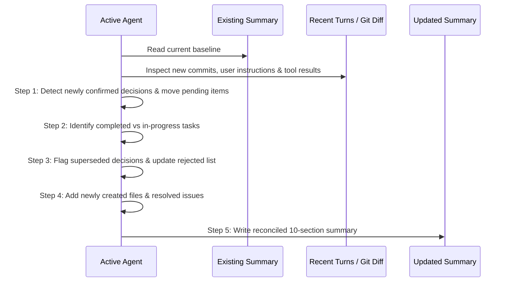

# Context Update & Reconciliation Workflow

A structured procedure for maintaining and incrementally updating context summaries across long-running projects, iterative chat sessions, or agent handoffs.

---

## 1. When to Update Context
- **Session Boundary**: At the conclusion of an active development session.
- **Milestone Completion**: When a major feature or bug fix has been committed and verified.
- **Requirement Pivot**: When the user alters, refines, or cancels a previously confirmed requirement.
- **Context Limit / Pre-Compaction**: Before calling context compaction or pruning a conversation.

---

## 2. 5-Step Diff & Reconciliation Process

### Step 1: Audit Recent Turns & Workspace State
Before writing the update, inspect:
1. `git log -n 5 --oneline` and `git status` to verify real code changes.
2. New user prompts in the conversation to capture approvals, feedback, or pivots.
3. Test or build results (confirm whether features actually work).

### Step 2: Reconcile Important Decisions
- If an item was in **Pending Decisions** and the user made a choice:
  - Move to **Confirmed Decisions** if accepted.
  - Move to **Rejected Approaches** if declined (with rationale).
- If the user reversed an earlier confirmed decision:
  - Mark previous decision in **Rejected Approaches** as: `[Old Decision] (Superseded on YYYY-MM-DD by [New Decision])`.
  - Add the new directive to **Confirmed Decisions**.

### Step 3: Advance Implementation Status
- Move items from **In Progress** to **Completed** only when verified by:
  - Working code in the workspace.
  - Git commit or passing tests.
- Update **In Progress** with the current active subtask.
- Move unblocked items from **Not Yet Implemented** to **Next Steps**.

### Step 4: Refresh Files & Code References
- Add any newly created files (e.g. newly generated assets, styles, components, scripts).
- Update file descriptions if responsibilities evolved.
- Remove references to deleted or archived files.

### Step 5: Redact Secrets & Finalize Next Conversation Instructions
- Scan for accidental credential leakage.
- Update the **Instructions for the Next Conversation** block to point directly to the new Next Steps #1.

---

## 3. Handling Requirement Conflicts & Supersessions

| Conflict Scenario | Resolution Rule | Example |
| :--- | :--- | :--- |
| User changes framework / library | Move old choice to Rejected, record replacement date in Confirmed. | Changed from SQLite to Supabase. Document why (e.g. multi-user cloud sync). |
| User reverts a visual design choice | Move reverted style to Rejected, restore original token in Confirmed. | Reverted header blur effect because of Safari performance glitch. |
| User changes mind on product pricing | Update Confirmed requirement, update current status note. | Shifted from hiding prices to showing placeholder `$XXX` during soft launch. |

---

## 4. Preservation Checklist
Before closing an update, verify:
- [ ] No previously rejected approaches were accidentally brought back as recommendations.
- [ ] No unconfirmed model suggestions were promoted to confirmed user decisions.
- [ ] Exact git branches, commit hashes, and file paths are accurate.
- [ ] All 10 standard sections are populated without omission.

