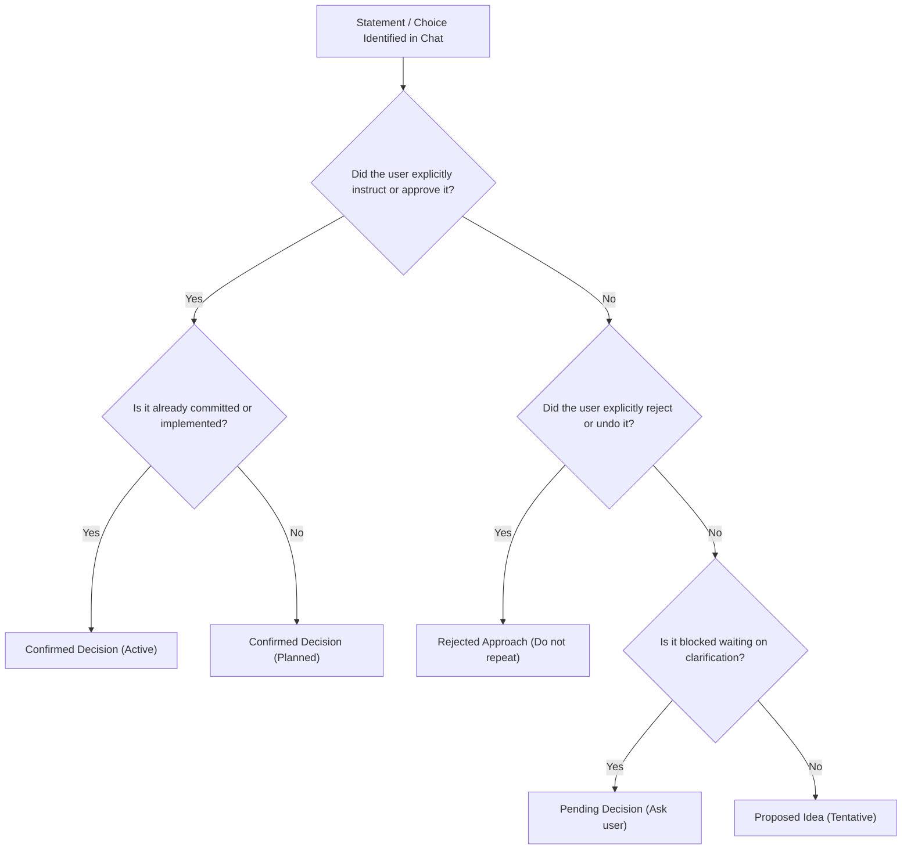

# Decision Classification Guide

A definitive reference for categorizing project statements, proposals, and choices into the four standard decision tiers. This prevents hallucinations, avoids elevating model suggestions into user requirements, and preserves genuine constraints.

---

## 1. The Four Decision Tiers

| Tier | Definition | Authority | Reversibility | Action for Next Agent |
| :--- | :--- | :--- | :--- | :--- |
| **Confirmed** | Explicitly stated, agreed to, or instructed by the user or project owner. | Binding | Only if user explicitly requests change | Must strictly honor and implement. |
| **Proposed** | Suggested by the model or user as an idea, exploration, or alternative, but not yet approved. | Tentative | High | May discuss or validate, but do NOT treat as mandatory. |
| **Rejected** | Considered and discarded. The user or team decided against this path with a recorded reason. | Negative Binding | Low | **NEVER re-propose or implement** without user initiative. |
| **Pending** | Identified requirement or design fork that is blocked or awaiting essential information. | Blocked | N/A | Prompt user or resolve dependency before continuing. |

---

## 2. Classification Heuristics & Signal Phrases

### Tier A: Confirmed Decisions
**Signals in Conversation**:
- *"Yes, let's do that."* / *"Go ahead with option B."*
- *"We should use PostgreSQL and Prisma."*
- *"Make the font Cormorant Garamond and background #FAF8F5."*
- Verified in code: Feature committed and accepted without objections.

**Examples**:
- ✅ `"Confirmed: Use GitHub Pages for hosting with CNAME configured to fairhomedecor.com."`
- ✅ `"Confirmed: Price tags remain '$XXX' during soft launch per user instruction."`

---

### Tier B: Proposed Ideas
**Signals in Conversation**:
- *"What if we tried Redis caching?"*
- *"We could potentially add a newsletter signup modal."*
- *"Model: I recommend implementing JWT refresh rotation in Phase 2."* (User has not yet agreed)

**Classification Rule**:
> **Warning**: Never record a model suggestion as a Confirmed Decision simply because the model proposed it in a previous turn. Unless the user gave explicit assent (`"Yes"`, `"Do that"`, `"Approved"`), it remains a **Proposed Idea**.

---

### Tier C: Rejected Approaches
**Signals in Conversation**:
- *"No, I don't want to use Bootstrap, keep it vanilla CSS."*
- *"We tried CSS 3D transforms for page transitions, but it broke modal fixed positioning, so we reverted it."*
- *"Don't add an external npm package for such a simple function."*

**Documentation Standard**:
Always capture the **rationale** along with the rejected item so future agents understand *why* it was abandoned.
- ❌ Bad: `"Rejected: Tailwind CSS."`
- ✅ Good: `"Rejected: Tailwind CSS — project uses vanilla CSS custom properties to maintain zero-build-step deployment."`

---

### Tier D: Pending Decisions
**Signals in Conversation**:
- *"Waiting on client brand assets before finalizing the logo SVG."*
- *"Do you want Stripe or LemonSqueezy for payment processing? (Awaiting user response)"*
- *"Need to decide whether to support offline caching with Service Workers."*

**Documentation Standard**:
Explicitly state what input or dependency is blocking resolution.

---

## 3. Decision Boundary Decision Tree

---

## 4. Common Classification Pitfalls

1. **The Model Suggestion Trap**:
   - *Scenario*: The model suggested in Turn 3: *"We should migrate the database to Supabase."* The user replied: *"Okay, but first fix the button styling."*
   - *Trap*: Marking Supabase migration as Confirmed.
   - *Correction*: Supabase remains a **Proposed Idea** (or Pending Decision); only the button styling is Confirmed.

2. **The Silent Reversion Trap**:
   - *Scenario*: In Turn 5, code was changed to add a header animation. In Turn 8, user asked to remove it because it was distracting.
   - *Trap*: Leaving header animation in Completed Status.
   - *Correction*: Move header animation to **Rejected Approaches** with note: *"Removed per user request due to visual clutter."*

