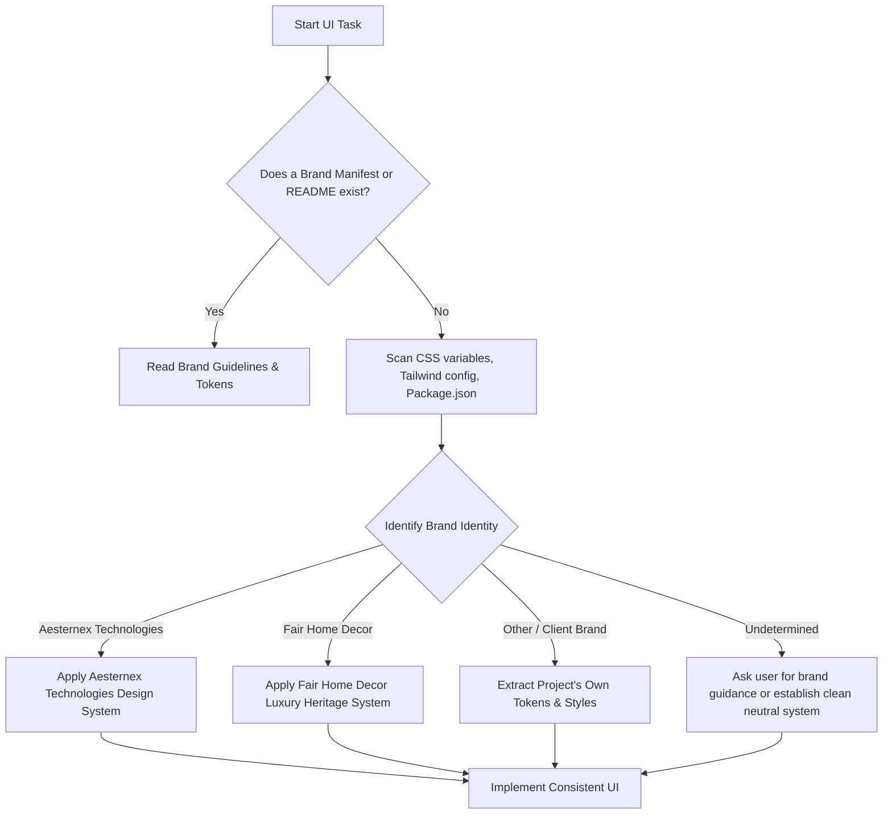

# System Design, Brand Identity & Design System

A standardized engineering skill to enforce brand consistency, semantic token architecture, accessible color systems, and reusable UI components across projects without introducing arbitrary styles or breaking existing conventions.

---

## 1. Core Operating Principles

1. **Brand Awareness Over Assumption**: Never assume every project shares the same branding. Always detect the active project's brand before selecting colors, typography, or visual treatments.
2. **Tokenized Styling Over Arbitrary Values**: Never hardcode arbitrary hex codes (`#2B2520`), random pixel margins (`margin-top: 19px`), or arbitrary z-indices (`z-index: 999999`). Always leverage semantic tokens and established CSS/Tailwind variables.
3. **Inspect Before Building**: Before writing a single line of CSS or component code, inspect the existing codebase for existing design tokens, components, utility classes, and layout conventions.
4. **Complete State Coverage**: Every interactive element must define its complete state machine: Rest, Hover, Focus-Visible, Active/Pressed, Disabled, Loading/Busy, and Validation (Error/Success).
5. **Accessibility by Default**: Ensure text meets WCAG AA contrast ratios (minimum 4.5:1 for normal text, 3:1 for large text), interactive targets are at least $44 \times 44\text{px}$ on touch devices, and mobile viewports prevent disruptive auto-zooming.

---

## 2. Brand Identity Detection Workflow

Before writing UI code, identify which brand identity governs the repository:



### Known Brand Profiles

#### Profile A: Aesternex Technologies
- **Industry & Persona**: High-performance technology, cloud infrastructure, AI engineering, enterprise software.
- **Visual Style**: Clean, modern, technical, sharp precision, dark/light dual-mode support, subtle glassmorphism, refined borders.
- **Palette Summary**:
  - Primary: Deep Tech Navy (`#0F172A` / `#1E293B`)
  - Accent / Brand: Electric Blue (`#2563EB` / `#3B82F6`)
  - Tech Accent: Cyber Cyan (`#06B6D4` / `#0EA5E9`)
  - Neutral Surface: Crisp White (`#FFFFFF`) or Slate (`#0B0F19` in dark mode)
  - Borders: Subdued Slate Border (`#E2E8F0` / dark `#334155`)
- **Typography**: Inter, Plus Jakarta Sans, SF Pro, or Fira Code (monospace accents).

#### Profile B: Fair Home Decor
- **Industry & Persona**: Artisanal furniture, handcrafted solid wood, luxury home decor, heirloom craftsmanship.
- **Visual Style**: Warm, grounded, understated luxury, natural textures, editorial serenity, generous whitespace.
- **Palette Summary**:
  - Primary Background: Warm Natural Linen / Warm Beige (`#FAF8F5` / `#F5F2ED`)
  - Primary Dark / Text: Deep Charcoal Brown (`#2B2520`)
  - Brand Accent: Sage Green (`#7C8C6E` / `#5A6B4E`)
  - Accent Gold / Sand: Warm Desert Sand (`#C8BC9E`)
  - Neutral Cream: Soft Cream (`#EDE9E1` / `#E8DFD0`)
  - Border: Soft Linen Tan (`#DDD5C5`)
- **Typography**: Cormorant Garamond (editorial serif headings) + Montserrat (clean geometric sans-serif body & labels).

#### Profile C: Other / Custom Client Brands
- Inspect `package.json`, `README.md`, `assets/css/style.css`, or `tailwind.config.js`.
- If no brand guidelines exist, create a [`brand-manifest.md`](./templates/brand-manifest-template.md) and ask the user to confirm primary brand colors.

---

## 3. Semantic Color System Architecture

Avoid referencing raw colors (like "blue" or "beige") directly in components. Map colors into **functional semantic roles**:

| Semantic Token Role | Purpose & Usage | Light Theme Example (FHD) | Tech Theme Example (Aesternex) |
|---|---|---|---|
| `--color-primary` | Main interactive brand anchor | `#2B2520` (Dark Brown) | `#2563EB` (Electric Blue) |
| `--color-primary-hover` | Hover / interactive state | `#5C4B3A` (Warm Brown) | `#1D4ED8` (Deep Blue) |
| `--color-secondary` | Secondary brand emphasis | `#7C8C6E` (Sage Green) | `#0F172A` (Deep Slate) |
| `--color-accent` | Focal points, badges, accents | `#C8BC9E` (Warm Sand) | `#06B6D4` (Cyan Accent) |
| `--color-bg` | Canvas / viewport background | `#FAF8F5` (Warm Linen) | `#F8FAFC` / `#0B0F19` (Dark) |
| `--color-surface` | Card / container background | `#FFFFFF` (Pure White) | `#FFFFFF` / `#1E293B` (Dark) |
| `--color-surface-subtle`| Secondary panels, table rows | `#F5F0E8` (Cream) | `#F1F5F9` / `#162032` (Dark) |
| `--color-border` | Standard card & field borders | `#DDD5C5` (Soft Tan) | `#E2E8F0` / `#334155` (Dark) |
| `--color-text-main` | High-contrast body text | `#2B2520` (Dark Brown) | `#0F172A` / `#F8FAFC` (Dark) |
| `--color-text-muted` | Supporting copy, timestamps | `rgba(43, 37, 32, 0.65)` | `#64748B` / `#94A3B8` (Dark) |
| `--color-success` | Success confirmations | `#4A6348` (Forest Olive) | `#16A34A` (Emerald) |
| `--color-warning` | Cautions and alerts | `#B8860B` (Amber Gold) | `#D97706` (Amber) |
| `--color-error` | Errors, deletions, warnings | `#A83232` (Crimson Brick) | `#DC2626` (Red) |
| `--color-info` | Informational announcements | `#4A6B82` (Slate Blue) | `#0284C7` (Sky Blue) |

---

## 4. Design Token Scales

### Spacing Scale (4px / 8px Grid Base)
```css
--space-1:   4px;
--space-2:   8px;
--space-3:  12px;
--space-4:  16px;
--space-5:  20px;
--space-6:  24px;
--space-8:  32px;
--space-10: 40px;
--space-12: 48px;
--space-16: 64px;
--space-20: 80px;
--space-24: 96px;
```

### Typography Scale (Fluid & Responsive)
```css
--font-xs:   0.75rem;    /* 12px - Footers, tags, metadata */
--font-sm:   0.875rem;   /* 14px - Supporting copy, table cells */
--font-base: 1rem;       /* 16px - Standard body text */
--font-lg:   1.125rem;   /* 18px - Subheadings, lead copy */
--font-xl:   1.25rem;    /* 20px - Card headers, modal titles */
--font-2xl:  clamp(1.5rem, 2.5vw, 1.875rem);   /* Section headers */
--font-3xl:  clamp(1.875rem, 3.5vw, 2.25rem); /* Major headlines */
--font-4xl:  clamp(2.5rem, 5vw, 3.75rem);      /* Hero display text */
```

### Border Radius Scale
```css
--radius-none: 0px;
--radius-sm:   4px;      /* Buttons, tags, badges */
--radius-md:   8px;      /* Cards, dropdowns, inputs */
--radius-lg:   12px;     /* Modals, featured banners */
--radius-full: 9999px;   /* Pills, circular avatars */
```

### Elevation & Shadow Scale
```css
--shadow-xs: 0 1px 2px rgba(0, 0, 0, 0.05);
--shadow-sm: 0 2px 8px rgba(43, 37, 32, 0.08);
--shadow-md: 0 6px 20px rgba(43, 37, 32, 0.10);
--shadow-lg: 0 12px 36px rgba(43, 37, 32, 0.14);
--shadow-xl: 0 24px 60px rgba(43, 37, 32, 0.22);
```

### Z-Index Layers
```css
--z-dropdown: 200;
--z-sticky:   300;
--z-fixed:    500;
--z-drawer:   800;
--z-backdrop: 9000;
--z-modal:    9999;
--z-toast:    10000;
```

### Transitions & Motion
```css
--ease-standard: cubic-bezier(0.2, 0, 0, 1);
--ease-bounce:   cubic-bezier(0.34, 1.56, 0.64, 1);
--duration-fast: 150ms;
--duration-base: 250ms;
--duration-slow: 400ms;
```

---

## 5. UI Component Guidelines & State Machine

When authoring any UI component, follow these strict rules:

### 1. Buttons (`.btn`)
- **Structure**: Minimum height of `44px` on touch devices; centered flex content; inline icon alignment with `gap: 8px`.
- **States Required**:
  - `rest`: Solid or outlined with token background and border.
  - `hover`: Distinct contrast change (e.g. `transform: translateY(-1px)`, subtle shadow lift).
  - `focus-visible`: `outline: 2px solid var(--color-primary)` with `outline-offset: 2px`.
  - `active`: Slight compression (`transform: scale(0.98)`).
  - `disabled`: `opacity: 0.55; cursor: not-allowed; pointer-events: none;`.
  - `loading`: Replaced or accompanied by an animated spinner or sending flight icon, `cursor: wait`.

### 2. Form Inputs & Textareas (`input`, `select`, `textarea`)
- **Mobile Safari Rule**: In `@media (max-width: 768px)`, enforce `font-size: 16px !important` on all inputs to prevent browser viewport auto-zooming.
- **Clear Borders**: 1px or 1.5px border using `--color-border`.
- **Focus Ring**: `border-color: var(--color-primary)` and subtle glow `box-shadow: 0 0 0 3px rgba(..., 0.15)`.
- **Error State**: `border-color: var(--color-error)` with accessible helper text below.

### 3. Cards (`.card`)
- Background: `--color-surface` (`#FFFFFF`).
- Border: Subdued 1px solid `--color-border`.
- Padding: Internal padding scaled by viewport (`16px` on mobile, `24px` to `32px` on desktop).
- Hover: If interactive/clickable, lift with `--shadow-md` and smooth `transform`.

### 4. Modals & Dialogs
- Backdrop: Deep blurred scrim (`rgba(26, 21, 18, 0.75)` with `backdrop-filter: blur(8px)`).
- Card: `max-height: 90vh; overflow-y: auto;` with padding that reduces on screens $\le 480\text{px}$.
- Close Button: Positioned at top-right with minimum $44 \times 44\text{px}$ touch target.
- Transform Isolation: Never place a CSS `transform` on `body` or modal ancestor elements, as CSS specs will break `position: fixed` containment.

---

## 6. Implementation Examples: Correct vs. Incorrect

### Example 1: Button Implementation

```html
<!-- ❌ INCORRECT: Arbitrary colors, inline px, no states, no accessibility -->
<button style="background: #2b2520; color: white; padding: 13px 29px; border-radius: 5px; font-size: 11px;">
  Submit
</button>
```

```html
<!-- ✅ CORRECT: Semantic tokens, responsive padding, complete states, accessible -->
<button type="submit" class="btn btn-primary" aria-label="Submit Order Inquiry">
  <span>Submit Inquiry</span>
  <svg class="btn-icon" width="16" height="16" viewBox="0 0 24 24" fill="none" stroke="currentColor">
    <path d="M5 12h14M12 5l7 7-7 7" stroke-width="2" stroke-linecap="round" stroke-linejoin="round"/>
  </svg>
</button>
```

```css
/* ✅ Associated Token-Driven CSS */
.btn {
  display: inline-flex;
  align-items: center;
  justify-content: center;
  gap: var(--space-2);
  min-height: 44px;
  padding: 12px 24px;
  font-family: var(--font-sans);
  font-size: var(--font-sm);
  font-weight: 600;
  letter-spacing: 0.12em;
  text-transform: uppercase;
  border-radius: var(--radius-sm);
  border: 1.5px solid transparent;
  cursor: pointer;
  transition: all var(--duration-base) var(--ease-standard);
}

.btn-primary {
  background: var(--color-primary);
  color: var(--color-white);
  border-color: var(--color-primary);
}

.btn-primary:hover:not(:disabled) {
  background: var(--color-primary-hover);
  border-color: var(--color-primary-hover);
  transform: translateY(-1px);
  box-shadow: var(--shadow-sm);
}

.btn-primary:focus-visible {
  outline: 2px solid var(--color-accent);
  outline-offset: 2px;
}

.btn-primary:active:not(:disabled) {
  transform: scale(0.98);
}

.btn:disabled {
  opacity: 0.5;
  cursor: not-allowed;
  pointer-events: none;
}
```

### Example 2: Responsive Grid Card

```css
/* ❌ INCORRECT: Hardcoded fixed columns breaking on mobile */
.grid-container {
  display: grid;
  grid-template-columns: 300px 300px 300px 300px;
  gap: 20px;
}

/* ✅ CORRECT: Fluid, mobile-first responsive grid using tokens */
.grid-container {
  display: grid;
  grid-template-columns: repeat(4, 1fr);
  gap: var(--space-5);
}

@media (max-width: 1024px) {
  .grid-container {
    grid-template-columns: repeat(2, 1fr);
    gap: var(--space-4);
  }
}

@media (max-width: 480px) {
  .grid-container {
    grid-template-columns: 1fr;
    gap: var(--space-3);
  }
}
```

---

## 7. Practical Implementation Checklist

When tasked with implementing or reviewing a UI:

1. [ ] **Detect Brand**: Inspect `README.md`, `package.json`, or logo assets to identify the governing brand.
2. [ ] **Check Tokens**: Verify if tokens are defined in `:root` or `tailwind.config.js`. If missing, generate them using [`design-tokens-template.css`](./templates/design-tokens-template.css).
3. [ ] **Reuse Components**: Check existing pages for existing navbar, card, modal, or button patterns before creating new ones.
4. [ ] **Audit States**: Ensure every interactive component handles Hover, Focus, Active, and Disabled states.
5. [ ] **Verify Mobile**: Ensure mobile layout does not overflow horizontally at $360\text{px}$, $375\text{px}$, or $390\text{px}$ viewports.
6. [ ] **Check iOS Zoom**: Ensure text inputs use $\ge 16\text{px}$ font size on mobile screens.
7. [ ] **Confirm Contrast**: Run a contrast check on text colors against backgrounds to ensure $\ge 4.5:1$ contrast.

